# zmk-molekula

Shield and default keymap for [Molekula2](https://github.com/zzeneg/molekula).

Supports ZMK Studio.

## Local build (Docker)

Prerequisites:
- [OrbStack](https://orbstack.dev/) or Docker Desktop running
- [just](https://github.com/casey/just) command runner
- Python 3 (for macOS USB serial detection when flashing)

### Setup
1. Copy `.env.example` to `.env` (adjust if needed):
   ```bash
   cp .env.example .env
   ```
2. Pull the container and fetch west modules:
   ```bash
   just setup
   ```

### Building Firmware
Build both keyboard halves (right and left):
```bash
just build-all
```
Outputs and build logs will be saved into `build-results/<timestamp>__<commit-sha>/`.
Builds always start with a clean build directory. Previous UF2 outputs are
removed before building; `build-all` removes both halves' previous outputs
up front so a failed build cannot leave older firmware available for flashing.

Individual builds:
```bash
just build-right   # central half
just build-left    # peripheral half
just build-reset   # settings reset
```

Build reset firmware separately once with `just build-reset`, then reuse it with
`just flash-reset`. `build-all` does not rebuild, remove, or archive reset firmware.
Rebuild reset firmware when needed after changing the controller board or updating
ZMK/Zephyr. `just clean` removes all build outputs, including the reset image.

### Flashing (XIAO BLE)
Register each physical half once on macOS. Connect the **right** half and
double-tap its reset button so its bootloader drive mounts, then run:

```bash
just register right
```

Repeat with the **left** half:

```bash
just register left
```

Only one UF2 bootloader may be mounted during registration. Each command saves
the board's hardware USB serial to the gitignored `.env`; no bootloader changes
are needed. To replace a registered board, remove its `UF2_RIGHT_SERIAL` or
`UF2_LEFT_SERIAL` entry from `.env` and register the replacement.

After registration:

1. Optional: back up currently running firmware (put that half in bootloader mode):
   ```bash
   just backup right
   just backup left
   ```
2. Double-tap reset button on the XIAO to mount bootloader volume (`XIAO-SENSE` / `XIAO-BOOT`).
3. Flash the matching half automatically:
   ```bash
   just flash
   ```

`just flash` selects the left or right firmware from the mounted board's saved
serial. If both registered halves are in bootloader mode, it refuses to choose;
use `just flash right` / `just flash left` (or `just flash-right` / `just flash-left`).
Explicit side commands fail immediately if only the wrong half or an unregistered
UF2 board is mounted. When no UF2 board is mounted, commands wait up to
`FLASH_TIMEOUT` seconds for bootloader mode.

Flashing and backups select the registered USB serial, regardless of the drive's
name or mount suffix. Both halves may be in bootloader mode for side-specific
commands. An unregistered board is never selected. `just list-devices` lists
mounted UF2 bootloaders and their serials.

`just flash reset` / `just flash-reset` select a registered board and require
exactly one registered board in bootloader mode. Put only the intended half in
bootloader mode before resetting it.

Flash commands use existing build outputs; run `just build-right` or
`just build-left` first to include your latest changes.
They read `build/molekula_tws_right/zephyr/zmk.uf2` or
`build/molekula_tws_left/zephyr/zmk.uf2` directly, never an archived file from
`build-results`. After a successful `just build-all`, these are the freshly built
images. Rebuild again if you edit the configuration or keymap afterward.

### Reflash both halves

```bash
just reflash             # use existing normal firmware builds
just reflash --rebuild   # build both halves first
```

Shared settings in `.env` (also documented in `.env.example`):

```dotenv
FLASH_TIMEOUT="30"
HOST_SIDE="r"
```

`FLASH_TIMEOUT` is a positive number of seconds per discovery attempt, shared by
flashing, reflashing, registration, and backups. `HOST_SIDE` must be `l` or `r`;
it controls central/peripheral labels and reflash order, not firmware roles.
The current TWS firmware uses `r`. Reflashing checks both generated `.config`
files against this setting and requires both registered serials and UF2 images.

The script prompts for the central first, then the peripheral. Connect the
requested half and double-tap reset. Each successful transfer marks that side
complete for this run. Timeouts and transfer/discovery failures retry until
success or Ctrl+C. Wrong, unknown, duplicate, or already-completed boards are
reported without copying to them; unchanged mismatch messages are not repeated
each second. If both halves are mounted, only the currently required half is
selected by serial.

Aligned status rows identify the step, side, role, and transfer status. Retry
attempts are shown only after a failure or timeout. Terminal colors
are disabled for redirected output or when `NO_COLOR` is set. Transfer success
means `cp -X` exited successfully, not that runtime keyboard operation was tested.
Ctrl+C prints the completed-side status and exits with code 130. Starting a new
run resets that status; it is not stored on disk. This workflow never flashes
settings-reset firmware and does not clear pairings. Existing single-side flash
commands still report wrong-side errors immediately rather than retrying.

## Keymap Visualization

The layout is rendered using [keymap-drawer](https://github.com/caksoylar/keymap-drawer) with Catppuccin dark mode styling and bilingual Cyrillic sublegends.

The image below uses the current branch's generated Molekula TWS SVG. The drawing
workflow regenerates and commits it when the TWS keymap or drawing inputs change,
using the same `just draw` pipeline as local generation. Click the image to open it.

```bash
just draw          # parse keymap and render keymap-drawer/molekula.svg
just show-keymap   # render and open molekula.svg
```

<div align="center">
  <a href="./keymap-drawer/molekula.svg"></a>
</div>

